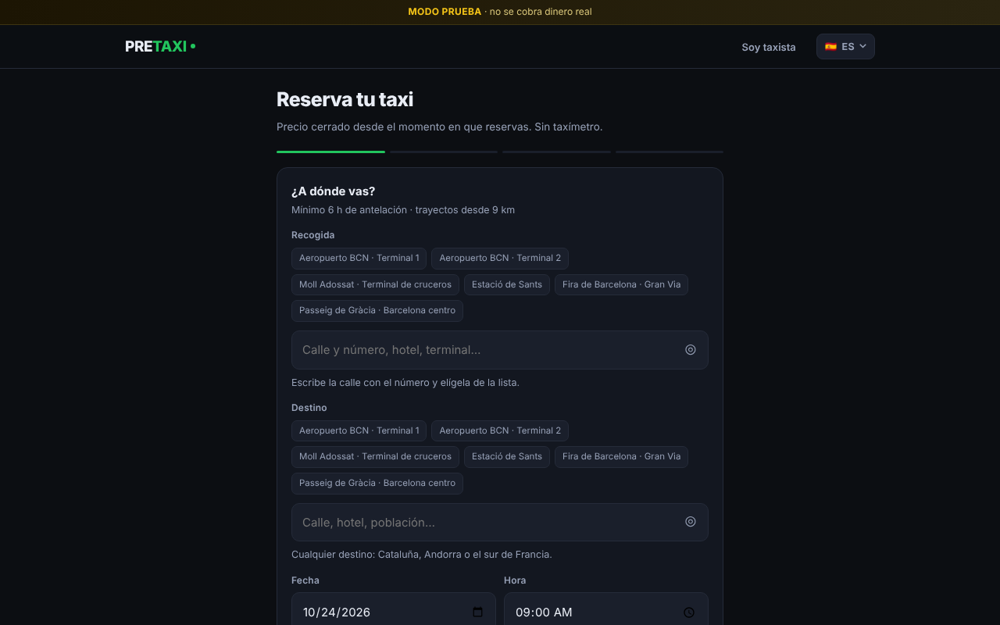
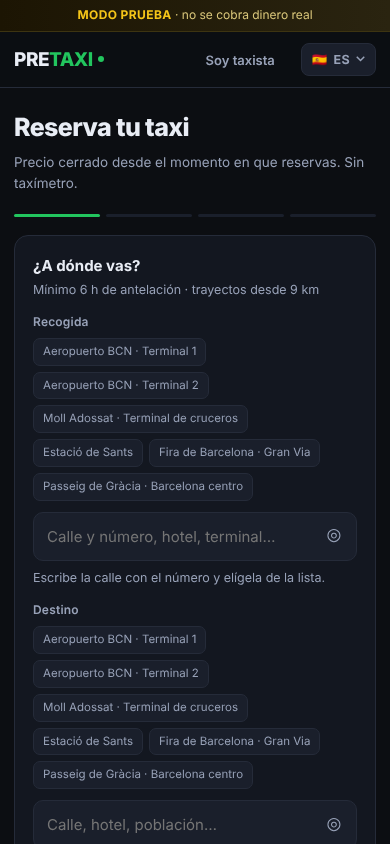

# PRETAXI

**Reserva tu taxi en Barcelona con antelación y con el precio cerrado antes de subir.**

[🌐 **Ver la web**](https://pretaxi-production.up.railway.app) — en modo prueba, no se cobra dinero real.

## Qué resuelve

Del aeropuerto, el puerto o la estación al centro, sin taxímetro y sin sorpresas por atascos o esperas.

- **Precio cerrado** calculado con la tarifa oficial del taxi en el momento de reservar.
- **Cobro al final:** el importe solo se reserva en la tarjeta y se cobra al terminar el trayecto.
- **10 idiomas**, incluidos catalán, inglés, árabe y urdu, pensando en viajeros y en taxistas.
- **Panel para taxistas** para recibir y gestionar los servicios.
- **Móvil primero:** se instala como app desde el navegador.

## Para emisoras de taxi

PRETAXI está pensado para que una emisora lo use con su propia marca. Si te interesa, abre un [*issue*](../../issues).

## Cómo está hecho

Aplicación web en PHP (Laravel), desplegada en Railway, con pagos con preautorización y diseño adaptable a móvil.

**Idea, producto y dirección:** Andreu Ferran. **Código:** desarrollado con IA (Claude) bajo mi dirección.

## Estado

🟢 **En línea en modo prueba.** Este repositorio es el escaparate del proyecto; el código fuente es privado.

---

© 2026 Andreu Ferran. Todos los derechos reservados.
